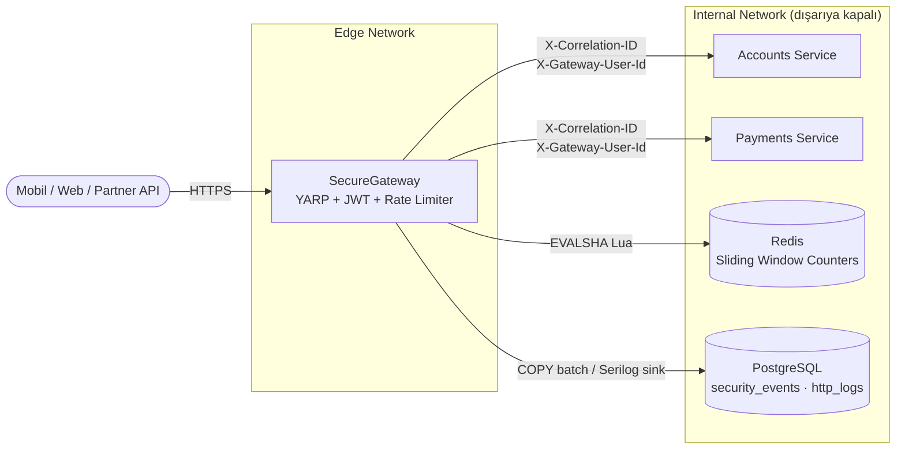
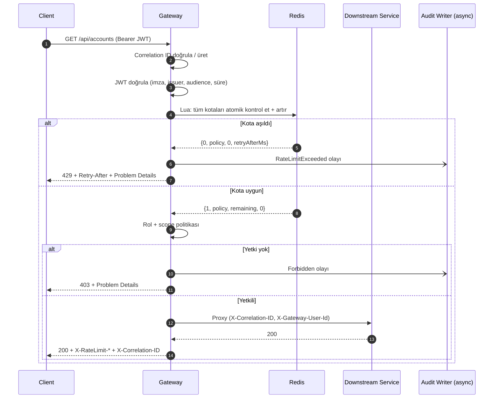

# SecureGateway — .NET 8 API Gateway & Distributed Rate Limiter

[](https://dotnet.microsoft.com/)
[](https://microsoft.github.io/reverse-proxy/)
[](https://redis.io/)
[](https://www.postgresql.org/)
[](LICENSE)

Bankacılık ve finans ekosistemlerindeki servisler arası trafiği tek bir güvenli giriş noktasından yöneten; kimlik doğrulama, rol/kapsam tabanlı yetkilendirme, **Redis üzerinde dağıtık Sliding Window rate limiting**, uçtan uca **Correlation ID** izlenebilirliği ve **güvenlik denetim kaydı (security audit trail)** sağlayan, kurumsal seviyede bir API Gateway referans uygulamasıdır.

> Bu depo bir portfolyo/referans projesidir. Gerçek müşteri verisi, gerçek anahtar veya gizli bilgi içermez; tüm bileşenler yerel ortamda (localhost / Docker) ve `.env` şablonu üzerinden çalışacak şekilde tasarlanmıştır.

---

## İçindekiler

1. [Projenin Amacı](#projenin-amacı)
2. [Öne Çıkan Özellikler](#öne-çıkan-özellikler)
3. [Mimari Genel Bakış](#mimari-genel-bakış)
4. [Katmanlı Mimari ve Proje Yapısı](#katmanlı-mimari-ve-proje-yapısı)
5. [İstek Yaşam Döngüsü](#istek-yaşam-döngüsü)
6. [Mimari Kararlar](#mimari-kararlar)
7. [Rotalar, Yetkiler ve Kotalar](#rotalar-yetkiler-ve-kotalar)
8. [Kurulum ve Çalıştırma](#kurulum-ve-çalıştırma)
9. [Uçtan Uca Deneme Senaryoları](#uçtan-uca-deneme-senaryoları)
10. [Loglama, Denetim ve İzlenebilirlik](#loglama-denetim-ve-izlenebilirlik)
11. [Yapılandırma Referansı](#yapılandırma-referansı)
12. [Testler ve CI](#testler-ve-ci)
13. [Production'a Geçiş Yol Haritası](#productiona-geçiş-yol-haritası)
14. [GitHub Topic'leri](#github-topicleri)
15. [Lisans](#lisans)

---

## Projenin Amacı

Finansal kurumlarda onlarca mikroservis (hesap, ödeme, kart, kredi, raporlama...) farklı ekipler tarafından geliştirilir ve her birinin kimlik doğrulama, istek sınırlandırma ve loglama gibi *kesişen kaygıları (cross-cutting concerns)* ayrı ayrı uygulaması hem maliyetli hem de risklidir. Tek bir hatalı yapılandırma; hesap ele geçirme denemelerine, core banking sistemlerinin aşırı yük altında çökmesine veya regülatör denetiminde izlenemeyen işlemlere yol açabilir.

**SecureGateway** bu kaygıları sistemin kenarında (edge) merkezileştirir:

- **Tek giriş noktası:** Dış dünya yalnızca gateway'i görür; iç servisler izole bir ağda kalır.
- **Önce koru, sonra yönlendir:** Her istek, downstream servise ulaşmadan önce kimlik, yetki ve kota kontrollerinden geçer.
- **Ölçeklenebilir koruma:** Kota sayaçları Redis'te tutulduğu için gateway yatayda N kopyaya çıkarıldığında limitler tutarlı kalır.
- **Denetlenebilirlik:** Kota aşımları, geçersiz token'lar ve yetkisiz erişim girişimleri sorgulanabilir bir veritabanı tablosunda kalıcı hâle gelir.

---

## Öne Çıkan Özellikler

| Alan | Uygulama |
|---|---|
| **Reverse Proxy** | Microsoft **YARP 2.3** — yapılandırma tabanlı rotalar, aktif sağlık kontrolü, `PowerOfTwoChoices` yük dengeleme |
| **Rate Limiting** | Redis sorted set üzerinde **Sliding Window Log**, tek **atomik Lua script**, Redis sunucu saati (`TIME`), çoklu politika *all-or-nothing* |
| **Bölümleme (Partition)** | `ClientIp`, `User` (JWT `sub`), `Endpoint` (rota geneli toplam kota) |
| **Kimlik Doğrulama** | JWT Bearer, `alg` kısıtlaması (HS256), issuer/audience/lifetime doğrulaması, kısa token ömrü |
| **Yetkilendirme** | Rol **ve** kapsam (scope) tabanlı politikalar, **secure-by-default** `FallbackPolicy` |
| **Kimlik Yayılımı** | Doğrulanmış kimlik `X-Gateway-User-Id` / `X-Gateway-User-Roles` başlıklarıyla iletilir; istemcinin gönderdiği sahte başlıklar silinir |
| **Correlation ID** | `X-Correlation-ID` doğrulanır / üretilir, tüm loglara, downstream servislere ve yanıta taşınır |
| **Güvenlik Denetimi** | Bounded `Channel` + arka plan yazıcı + PostgreSQL **binary COPY** ile toplu yazım (`security_events`) |
| **HTTP Logları** | Serilog → Konsol (JSON) + PostgreSQL (`http_logs`) — korelasyon, IP, kullanıcı, rota ayrı kolonlarda |
| **Sertleştirme** | Güvenlik başlıkları, `Server` başlığının gizlenmesi, istek boyutu limitleri, güvenilir proxy listesi, RFC 9457 Problem Details |
| **Operasyon** | `/health/live`, `/health/ready` (Redis + PostgreSQL), Docker Compose, GitHub Actions CI |

---

## Mimari Genel Bakış



Docker Compose topolojisi de bu ayrımı birebir uygular: yalnızca gateway host'a port açar; servisler, Redis ve PostgreSQL `internal: true` olarak işaretlenmiş bir ağda çalışır ve dış dünyaya rotaları yoktur.

---

## Katmanlı Mimari ve Proje Yapısı

Proje, **Clean Architecture** prensiplerine göre bağımlılıkların yalnızca içe doğru aktığı katmanlara ayrılmıştır:

```
dotnet-secure-api-gateway/
├── src/
│   ├── SecureGateway.Domain/           # Saf alan modeli: SecurityEvent, SecurityEventType, SecuritySeverity
│   ├── SecureGateway.Application/      # Sözleşmeler ve politikalar: IRateLimiter, ISecurityEventStore,
│   │                                   #   RateLimitingOptions + Validator, RateLimitKeyBuilder
│   ├── SecureGateway.Infrastructure/   # Adaptörler: RedisSlidingWindowRateLimiter (Lua),
│   │                                   #   PostgresSecurityEventStore (COPY), SecurityEventChannel/Writer, HealthChecks
│   └── SecureGateway.Gateway/          # Composition root: HTTP pipeline, YARP, JWT, middleware'ler, Serilog
├── samples/
│   ├── SecureGateway.Samples.AccountsService/   # Örnek downstream servis (hesaplar, döviz kurları)
│   └── SecureGateway.Samples.PaymentsService/   # Örnek downstream servis (ödeme emirleri)
├── tests/SecureGateway.UnitTests/      # xUnit testleri
├── docs/requests.http                  # Hazır demo istekleri
├── docker-compose.yml                  # Tam sistem (gateway + servisler + Redis + PostgreSQL)
├── docker-compose.dev.yml              # Yalnızca altyapı (IDE'den geliştirme için)
├── Directory.Packages.props            # Central Package Management — tüm NuGet sürümleri tek yerde
└── .env.example                        # Ortam değişkeni şablonu (gerçek değer içermez)
```

| Katman | Bağımlı Olduğu | Sorumluluk |
|---|---|---|
| Domain | — | İş kavramları; framework bağımsız |
| Application | Domain | Port (arayüz) tanımları, kota politikaları, doğrulama kuralları |
| Infrastructure | Application | Redis ve PostgreSQL adaptörleri; dış sistemlerle konuşan tek katman |
| Gateway | Infrastructure | HTTP pipeline, YARP, kimlik doğrulama ve bileşenlerin birleştirilmesi |

Bu ayrım sayesinde örneğin Redis yerine başka bir dağıtık depo veya PostgreSQL yerine MSSQL kullanmak, yalnızca `Infrastructure` katmanında yeni bir adaptör yazmak anlamına gelir.

---

## İstek Yaşam Döngüsü

Middleware sırası bir stil tercihi değil, **güvenlik kararıdır**:

```
ForwardedHeaders* → CorrelationId → SecurityHeaders → ExceptionHandler → RequestLogging
   → Routing → Authentication → RateLimiting → Authorization → Endpoint (YARP / yerel)
```
<sub>* Yalnızca güvenilir proxy/ağ tanımlandığında devreye girer.</sub>



**Neden rate limiting, authentication'dan sonra ama authorization'dan önce?**

- *Authentication'dan sonra:* Kullanıcı bazlı kotaların, çağıranın kim olduğunu (`sub` claim) bilmesi gerekir.
- *Authorization'dan önce:* Anonim saldırı trafiği ve kaba kuvvet (brute-force) denemeleri, politika değerlendirmesi veya downstream çağrısı yapılmadan en ucuz noktada kesilir.

---

## Mimari Kararlar

### ADR-01 — Reverse proxy olarak YARP

YARP, Microsoft tarafından Azure'un kendi altyapısında kullanılan, ASP.NET Core pipeline'ına doğal olarak entegre olan yüksek performanslı bir reverse proxy kütüphanesidir. Özel bir proxy yazmak yerine YARP tercih edilmesinin nedenleri:

- Kimlik doğrulama, yetkilendirme ve middleware ekosisteminin **aynı süreç içinde** kullanılabilmesi,
- Rotaların, cluster'ların ve sağlık kontrollerinin yapılandırma ile yönetilmesi (yeniden derleme gerektirmez),
- `AddTransforms` ile kimlik yayılımı gibi özel dönüşümlerin tip güvenli şekilde eklenebilmesi.

Rota başına kota politikası, YARP rotalarının `Metadata` alanı üzerinden tanımlanır; böylece yeni bir servis eklemek yalnızca yapılandırma değişikliğidir.

### ADR-02 — Sliding Window Log algoritması

| Algoritma | Sınır patlaması (boundary burst) | Kesinlik | Bellek | Değerlendirme |
|---|---|---|---|---|
| Fixed Window | **Var** (pencere sınırında 2× istek) | Düşük | O(1) | Finansal API'ler için yetersiz |
| Token Bucket | Kontrollü patlamaya izin verir | Orta | O(1) | Patlamaya izin vermek istenmeyen ödeme uçlarına uygun değil |
| Sliding Window Counter | Yok (yaklaşık) | Orta–Yüksek | O(1) | Çok yüksek limitler için iyi bir alternatif |
| **Sliding Window Log** | **Yok** | **Tam** | O(limit) | **Seçildi** |

Her kabul edilen istek, Redis sorted set'ine milisaniye cinsinden zaman damgasıyla eklenir. Her değerlendirmede pencere dışına düşen kayıtlar silinir ve kalan kayıt sayısı limitle karşılaştırılır. Böylece **herhangi bir anda, son `Window` süresi içinde en fazla `PermitLimit` istek** bulunduğu matematiksel olarak garanti edilir. Ödeme ve para transferi gibi uçlarda bu kesinlik, birkaç kilobaytlık ek bellek maliyetine değerdir.

> Bilinçli bir takas: Bellek kullanımı limitle orantılıdır. Dakikada on binlerce isteklik çok yüksek limitler için *Sliding Window Counter* adaptörü eklenebilir; `IRateLimiter` sözleşmesi buna hazırdır.

### ADR-03 — Atomik Lua script ve Redis sunucu saati

Kontrol-ve-artır işlemi tek bir Lua script'i içinde çalışır (`RedisSlidingWindowRateLimiter.SlidingWindowScript`). Redis script'leri atomik yürüttüğü için:

1. **Yarış durumu (race condition) yoktur:** N adet gateway kopyası aynı anda aynı sayacı güncelleyemez.
2. **Tek ağ gidiş-dönüşü:** `StackExchange.Redis` script'in SHA'sını önbelleğe alır ve `EVALSHA` kullanır.
3. **Saat kayması (clock skew) etkisizdir:** Zaman, gateway sunucularından değil `redis.call('TIME')` ile Redis'ten alınır. Farklı makinelerin saatleri arasındaki sapma kotaları büyütemez veya küçültemez.

### ADR-04 — Çoklu politika, *all-or-nothing* semantiği

Bir rotaya birden fazla kota bağlanabilir. Örneğin ödeme rotası:

- `payments-per-user` → kullanıcı başına **10 istek / 60 sn** (hesap ele geçirme ve otomasyon kötüye kullanımına karşı),
- `payments-endpoint-guard` → tüm kullanıcılar için toplam **1000 istek / 60 sn** (core banking sistemini aşırı yükten korumak için).

Lua script önce **tüm** sayaçları kontrol eder; yalnızca hepsi uygunsa **hepsini** artırır. Böylece reddedilen bir istek, diğer politikaların kotasından haksız yere düşmez.

### ADR-05 — Redis Cluster uyumlu anahtar tasarımı

```
gw:rl:{payments-route}:payments-per-user:user:customer-42
gw:rl:{payments-route}:payments-endpoint-guard:endpoint:all
```

Rota kimliği süslü parantez içinde bir **hash tag**'dir. Aynı rotaya ait tüm sayaçlar aynı Redis Cluster slot'una düşer; bu sayede çok anahtarlı Lua script'i `CROSSSLOT` hatası almadan çalışır. Farklı rotalar ise farklı shard'lara dağılarak sıcak nokta (hot shard) oluşumu engellenir. 128 karakteri aşan bölüm değerleri SHA-256 ile özetlenerek anahtar boyutu sınırlandırılır.

### ADR-06 — Redis erişilemezse: Fail-Open mı, Fail-Closed mı?

Bu bir risk iştahı kararıdır ve yapılandırılabilir (`RateLimiting:FailOpen`):

- **Fail-Open (varsayılan):** Redis kesintisinde trafik akmaya devam eder; erişilebilirlik önceliklidir. Kimlik doğrulama ve yetkilendirme yine çalışır.
- **Fail-Closed:** Trafik `503` ile reddedilir; koruma önceliklidir.

Her iki durumda da olay `Critical` seviyesinde loglanır ve `RateLimiterUnavailable` güvenlik olayı üretilir. Kesinti sırasında denetim tablosunu taşırmamak için bu olay **30 saniyede en fazla bir kez** yazılır.

### ADR-07 — Güvenlik denetim kaydı: istek yolunu asla bloklama

Güvenlik olayları istek thread'inde veritabanına yazılmaz. Bunun yerine:

```
İstek thread'i ──TryWrite (O(1), lock-free)──► Bounded Channel (10.000) ──► SecurityEventWriter (BackgroundService)
                                                                              └─ 250'lik batch / 1 sn ──► PostgreSQL binary COPY
```

- Yavaş veya erişilemeyen bir veritabanı, proxy edilen trafiğe **gecikme eklemez**.
- Binary `COPY`, PostgreSQL'in sunduğu en hızlı toplu yazma yoludur; saldırı anında saniyede binlerce olay üretilse bile maliyet düşük kalır.
- Kuyruk dolarsa olay düşürülür, düşürülen sayısı sayılır ve `Error` seviyesinde loglanır. Her olay ayrıca yapılandırılmış log olarak da yazıldığından iz tamamen kaybolmaz.
- Uygulama kapanırken kuyruk 10 saniyelik zaman aşımıyla boşaltılır (graceful shutdown).

### ADR-08 — Secure-by-default yetkilendirme

- `FallbackPolicy = RequireAuthenticatedUser()`: Açıkça politika belirtilmemiş **her** uç (yeni eklenen bir YARP rotası dahil) kimlik doğrulaması ister. Herkese açık rotalar, `AuthorizationPolicy: "Anonymous"` ile **bilinçli olarak** açılmalıdır.
- Politikalar **rol + scope** birlikteliğini ister. Rol "kim olduğunu", scope ise "token'ın ne için verildiğini" ifade eder; sızdırılan bir token'ın etki alanı böylece daralır.
- `ValidAlgorithms = [HS256]` ile `alg` karışıklığı / düşürme saldırıları engellenir.
- Nesne seviyesinde yetkilendirme (bir müşterinin yalnızca kendi hesabını görmesi — BOLA/IDOR koruması) bilinçli olarak sahibi olan serviste bırakılmıştır; örnek servisler bunu gösterir.

### ADR-09 — Kimlik yayılımı ve başlık sahteciliğine karşı koruma

Downstream servisler gateway'in doğruladığı kimliği `X-Gateway-User-Id`, `X-Gateway-User-Roles` ve `X-Gateway-Client-Ip` başlıklarından okur. YARP transform'u, istemciden gelen bu adlardaki **tüm başlıkları önce siler**, ardından doğrulanmış değerleri ekler. Bu adım olmadan bir saldırgan `X-Gateway-User-Id: baska-musteri` göndererek başkasını taklit edebilirdi.

### ADR-10 — Correlation ID ve istemci IP güvenliği

- İstemcinin gönderdiği `X-Correlation-ID` yalnızca **en fazla 64 karakter ve `[A-Za-z0-9-_.]`** ise kabul edilir; aksi hâlde yenisi üretilir. Bu, log enjeksiyonunu (ör. CRLF) ve sınırsız başlık değerlerini engeller.
- `X-Forwarded-For` başlığına **varsayılan olarak güvenilmez.** Aksi hâlde bir saldırgan her istekte farklı IP göndererek IP tabanlı kotalardan kaçabilirdi. Gateway bir yük dengeleyicinin arkasındaysa `ForwardedHeaders:KnownProxies` / `KnownNetworks` açıkça tanımlanmalıdır.

---

## Rotalar, Yetkiler ve Kotalar

| Gateway Yolu | Hedef | Yetki Politikası | Gerekli Rol | Gerekli Scope | Kota Politikaları |
|---|---|---|---|---|---|
| `GET /api/accounts/**` | Accounts | `AccountsRead` | Customer, Teller, Admin | `accounts:read` | `accounts-per-user` |
| `GET /api/public/fx-rates` | Accounts | `Anonymous` | — | — | `public-ip` |
| `* /api/payments/**` | Payments | `PaymentsWrite` | Customer, Admin | `payments:write` | `payments-per-user` + `payments-endpoint-guard` |
| `GET /gateway/security-events` | Gateway | `SecurityAuditRead` | Auditor, Admin | `audit:read` | `audit-per-user` |
| `POST /auth/dev-token` | Gateway | Anonim (yalnızca demo) | — | — | `auth-ip` |
| `GET /health/live`, `/health/ready` | Gateway | Anonim | — | — | Muaf |
| Eşleşmeyen tüm yollar | — | Fallback (kimlik zorunlu) | — | — | `default` |

| Politika | Bölümleme | Limit |
|---|---|---|
| `default` | ClientIp | 100 / 60 sn |
| `public-ip` | ClientIp | 30 / 60 sn |
| `auth-ip` | ClientIp | 5 / 60 sn |
| `accounts-per-user` | User | 60 / 60 sn |
| `payments-per-user` | User | 10 / 60 sn |
| `payments-endpoint-guard` | Endpoint | 1000 / 60 sn |
| `audit-per-user` | User | 30 / 60 sn |

Her yanıtta `X-RateLimit-Limit`, `X-RateLimit-Remaining` ve `X-RateLimit-Policy` başlıkları döner; reddedilen isteklerde ayrıca `Retry-After` (saniye) bulunur. Kota politikaları uygulama başlangıcında doğrulanır (`RateLimitingOptionsValidator`); tutarsız bir yapılandırma (tanımsız varsayılan politika, tekrar eden ad, sıfır limit vb.) uygulamanın **başlamasını engeller**.

---

## Kurulum ve Çalıştırma

### Gereksinimler

- [.NET 8 SDK](https://dotnet.microsoft.com/download/dotnet/8.0) (veya daha yeni bir SDK; `global.json` ileri sürüme izin verir)
- [Docker Desktop](https://www.docker.com/products/docker-desktop/) veya Docker Engine + Compose v2
- (İsteğe bağlı) `curl` ve `jq`

### Seçenek A — Tüm sistemi Docker Compose ile çalıştırma

```bash
git clone https://github.com/<kullanici-adi>/dotnet-secure-api-gateway.git
cd dotnet-secure-api-gateway

# 1) Ortam değişkeni şablonunu kopyalayın ve TÜM değerleri değiştirin
cp .env.example .env

# Rastgele değer üretmek için örnek:
#   openssl rand -base64 48

# 2) Sistemi derleyip başlatın
docker compose up --build -d

# 3) Hazır olup olmadığını kontrol edin
curl -s http://localhost:8080/health/ready
```

Gateway `http://localhost:8080` adresinde yayın yapar. Redis, PostgreSQL ve örnek servisler dışarıya kapalı `backend` ağındadır.

### Seçenek B — Altyapı Docker'da, uygulamalar IDE'den

Geliştirme sırasında hata ayıklayıcı (debugger) kullanmak için önerilen yöntemdir.

```bash
# 1) Yalnızca Redis ve PostgreSQL'i başlatın (127.0.0.1'e bağlı, yerel geliştirme kimlik bilgileriyle)
docker compose -f docker-compose.dev.yml up -d

# 2) Üç ayrı terminalde servisleri çalıştırın
dotnet run --project samples/SecureGateway.Samples.AccountsService   # http://localhost:5101
dotnet run --project samples/SecureGateway.Samples.PaymentsService   # http://localhost:5102
dotnet run --project src/SecureGateway.Gateway                       # http://localhost:5000
```

`appsettings.Development.json` içindeki bağlantı bilgileri yalnızca `docker-compose.dev.yml` ile eşleşen, **gizli olmayan yerel değerlerdir**. Kendi değerlerinizi kullanmak isterseniz:

```bash
cd src/SecureGateway.Gateway
dotnet user-secrets set "Jwt:SigningKey" "<en-az-32-karakterlik-rastgele-deger>"
```

### Redis kurulumu ve incelenmesi

Docker Compose dışında bağımsız bir Redis örneği isterseniz:

```bash
docker run -d --name gateway-redis -p 127.0.0.1:6379:6379 redis:7.4-alpine
```

Rate limiter anahtarlarını canlı olarak incelemek için:

```bash
# Seçenek B (dev compose)
docker compose -f docker-compose.dev.yml exec redis redis-cli --scan --pattern 'gw:rl:*'
docker compose -f docker-compose.dev.yml exec redis redis-cli ZRANGE 'gw:rl:{payments-route}:payments-per-user:user:customer-42' 0 -1 WITHSCORES

# Seçenek A (parola korumalı)
docker compose exec redis sh -c 'redis-cli -a "$REDIS_PASSWORD" --no-auth-warning --scan --pattern "gw:rl:*"'
```

Her anahtar, pencere süresi kadar `PEXPIRE` ile işaretlendiği için trafik durduğunda Redis kendini otomatik olarak temizler.

---

## Uçtan Uca Deneme Senaryoları

Aşağıdaki örnekler Seçenek B (`http://localhost:5000`) içindir; Docker Compose için `8080` kullanın. Aynı istekler [`docs/requests.http`](docs/requests.http) dosyasında VS Code REST Client / JetBrains HTTP Client için hazırdır.

```bash
GW=http://localhost:5000

# 1) Müşteri token'ı alın (yalnızca demo amaçlı dev token uç noktası)
TOKEN=$(curl -s -X POST $GW/auth/dev-token -H "Content-Type: application/json" \
  -d '{"subject":"customer-42","roles":["Customer"],"scopes":["accounts:read","payments:write"]}' | jq -r .accessToken)

# 2) Hesapları listeleyin — yanıt başlıklarındaki korelasyon ve kota bilgisini inceleyin
curl -i $GW/api/accounts -H "Authorization: Bearer $TOKEN" -H "X-Correlation-ID: demo-001"

# 3) Kota aşımını gözlemleyin: 11. ödeme isteği 429 döner
for i in $(seq 1 11); do
  curl -s -o /dev/null -w "%{http_code}\n" -X POST $GW/api/payments \
    -H "Authorization: Bearer $TOKEN" -H "Content-Type: application/json" \
    -d '{"fromAccountId":"ACC-1","toIban":"TR000000000000000000000001","amount":100,"currency":"TRY"}'
done

# 4) Anonim erişim denemesi → 401
curl -i $GW/api/accounts

# 5) Müşterinin denetim kaydına erişim denemesi → 403
curl -i $GW/gateway/security-events -H "Authorization: Bearer $TOKEN"

# 6) Denetçi (Auditor) olarak güvenlik olaylarını sorgulayın
AUDITOR=$(curl -s -X POST $GW/auth/dev-token -H "Content-Type: application/json" \
  -d '{"subject":"auditor-01","roles":["Auditor"],"scopes":["audit:read"]}' | jq -r .accessToken)
curl -s "$GW/gateway/security-events?take=20" -H "Authorization: Bearer $AUDITOR" | jq
```

Örnek `429` yanıtı:

```http
HTTP/1.1 429 Too Many Requests
Content-Type: application/problem+json
Retry-After: 47
X-RateLimit-Limit: 10
X-RateLimit-Remaining: 0
X-RateLimit-Policy: payments-per-user
X-Correlation-ID: 9b1c0e6f5a3d4e0f8c2b7a6d5e4f3a2b

{
  "type": "https://httpstatuses.io/429",
  "title": "Too Many Requests",
  "status": 429,
  "detail": "The request quota for this resource has been exceeded. Retry after the indicated delay.",
  "instance": "/api/payments",
  "correlationId": "9b1c0e6f5a3d4e0f8c2b7a6d5e4f3a2b",
  "policy": "payments-per-user",
  "retryAfterSeconds": 47
}
```

> **Not:** `POST /auth/dev-token` yalnızca demo içindir. `DevTokenIssuer:Enabled=true` olsa bile `Production` ortamında **zorla devre dışı** bırakılır. Gerçek senaryoda token'lar Keycloak, Microsoft Entra ID veya Duende IdentityServer gibi bir kimlik sağlayıcıdan alınır; gateway yalnızca doğrular.

---

## Loglama, Denetim ve İzlenebilirlik

### Correlation ID akışı

1. İstemci `X-Correlation-ID` gönderirse doğrulanır; göndermezse gateway üretir.
2. Değer `HttpContext.TraceIdentifier`, Serilog `LogContext` ve `Activity` etiketine yazılır.
3. YARP, aynı başlığı downstream servise iletir; örnek servisler bunu kendi log scope'larına ekler.
4. Yanıtta istemciye geri döner ve her Problem Details gövdesinde `correlationId` alanı bulunur.

Sonuç: Bir müşteri şikâyetindeki tek bir ID ile gateway logu, servis logu, `http_logs` ve `security_events` kayıtları birbirine bağlanabilir.

### Veritabanı tabloları

| Tablo | Kaynak | İçerik |
|---|---|---|
| `security_events` | `PostgresSecurityEventStore` (binary COPY) | Kota aşımı, geçersiz token, 401, 403, rate limiter kesintisi |
| `http_logs` | Serilog PostgreSQL sink | Her HTTP isteği için tek satır (metot, yol, durum kodu, süre, IP, kullanıcı, rota, korelasyon) + tüm uyarı/hatalar |

Tablolar uygulama başlangıcında otomatik oluşturulur (`CREATE TABLE IF NOT EXISTS`). Sorgu yollarına uygun indeksler (`occurred_at_utc`, `event_type`, `correlation_id`, `client_ip`) tanımlıdır.

> Gizlilik (KVKK/GDPR): Query string'ler, istek gövdeleri ve token içerikleri bilinçli olarak loglanmaz. Geçersiz token olaylarında yalnızca hata türü (ör. `SecurityTokenExpiredException`) kaydedilir.

### Örnek denetim sorguları

```sql
-- Son 15 dakikada en çok kota aşımı yapan IP adresleri
SELECT client_ip, COUNT(*) AS violations
FROM security_events
WHERE event_type = 'RateLimitExceeded' AND occurred_at_utc > now() - interval '15 minutes'
GROUP BY client_ip ORDER BY violations DESC LIMIT 10;

-- Tek bir korelasyon ID'sinin tüm izi
SELECT 'http' AS source, logged_at_utc AS at, level, message FROM http_logs WHERE correlation_id = 'demo-001'
UNION ALL
SELECT 'security', occurred_at_utc, severity, event_type || ': ' || coalesce(details, '') FROM security_events WHERE correlation_id = 'demo-001'
ORDER BY at;

-- Yetkisiz erişim denemeleri (403) — hangi kullanıcı hangi rotayı zorluyor?
SELECT user_id, route_id, COUNT(*) FROM security_events
WHERE event_type = 'Forbidden' GROUP BY user_id, route_id ORDER BY 3 DESC;
```

```bash
# Seçenek A
docker compose exec postgres psql -U gateway -d secure_gateway
```

---

## Yapılandırma Referansı

Tüm ayarlar `appsettings.json` içinde tanımlıdır ve ASP.NET Core kuralına göre ortam değişkenleriyle ezilebilir (`:` yerine `__`).

| Ayar | Ortam Değişkeni | Açıklama |
|---|---|---|
| `ConnectionStrings:Redis` | `ConnectionStrings__Redis` | StackExchange.Redis bağlantı dizesi |
| `ConnectionStrings:SecurityAudit` | `ConnectionStrings__SecurityAudit` | PostgreSQL bağlantı dizesi |
| `Jwt:Issuer` / `Jwt:Audience` | `Jwt__Issuer` / `Jwt__Audience` | Beklenen token yayıncısı ve hedef kitlesi |
| `Jwt:SigningKey` | `Jwt__SigningKey` | HS256 anahtarı (en az 32 karakter; başlangıçta doğrulanır) |
| `Jwt:AccessTokenLifetimeMinutes` | `Jwt__AccessTokenLifetimeMinutes` | Dev token ömrü (varsayılan 15 dk) |
| `RateLimiting:Enabled` | `RateLimiting__Enabled` | Acil durum anahtarı |
| `RateLimiting:FailOpen` | `RateLimiting__FailOpen` | Redis kesintisinde davranış |
| `RateLimiting:Policies` | — | Politika listesi (ad, bölümleme, limit, pencere) |
| `ReverseProxy:Routes:*:Metadata:RateLimitPolicies` | — | Rotaya bağlı politikalar (virgülle ayrılmış) |
| `SecurityAudit:*` | `SecurityAudit__*` | Kuyruk kapasitesi, batch boyutu, flush aralığı |
| `ForwardedHeaders:KnownProxies` | — | Güvenilir proxy IP'leri (boşsa `X-Forwarded-For` yok sayılır) |
| `DevTokenIssuer:Enabled` | `DevTokenIssuer__Enabled` | Demo token uç noktası (Production'da her zaman kapalı) |
| `Logging:Database:Enabled` | `Logging__Database__Enabled` | `http_logs` PostgreSQL sink'i |

---

## Testler ve CI

```bash
dotnet test
```

Birim testleri şunları kapsar:

- Redis anahtar tasarımı (hash tag, uzun değerlerin özetlenmesi, süslü parantez temizliği),
- Kota yapılandırması doğrulayıcısı,
- Correlation ID doğrulama ve log enjeksiyonuna karşı koruma,
- Rate limiting middleware'i: izin, `429` + `Retry-After`, güvenlik olayı üretimi, fail-open / fail-closed,
- Dev token isteği doğrulaması (tanımsız rol/scope ile yetki yükseltme denemeleri).

`.github/workflows/ci.yml`, her push ve pull request'te çözümü derler, testleri çalıştırır ve Docker imajlarını oluşturur.

---

## Production'a Geçiş Yol Haritası

Bu proje bir referans uygulamadır. Gerçek bir bankacılık ortamına alınmadan önce önerilen adımlar:

- [ ] **Asimetrik imza ve JWKS:** HS256 yerine RS256/ES256 ve kimlik sağlayıcının JWKS uç noktasından anahtar rotasyonu (`Authority` tabanlı yapılandırma).
- [ ] **Redis yüksek erişilebilirlik:** Sentinel veya Cluster; TLS ve ACL kullanıcıları.
- [ ] **mTLS:** Gateway ile downstream servisler arasında karşılıklı TLS (service mesh veya YARP `HttpClient` sertifikaları).
- [ ] **OpenTelemetry:** Correlation ID'nin W3C `traceparent` ile birleştirilmesi; Jaeger/Tempo'ya dağıtık izleme.
- [ ] **Veritabanı yaşam döngüsü:** Şema yönetimi için migration aracı (ör. Flyway/DbUp), `security_events` için zaman bazlı partitioning ve saklama (retention) politikası.
- [ ] **Merkezi gizli bilgi yönetimi:** Azure Key Vault, HashiCorp Vault veya Kubernetes Secrets.
- [ ] **WAF ve DDoS koruması:** Uygulama seviyesi rate limiting'in önünde ağ seviyesi koruma.
- [ ] **Entegrasyon testleri:** Testcontainers ile gerçek Redis/PostgreSQL üzerinde Lua script ve COPY testleri.

---

## GitHub Topic'leri

Depo ayarlarında **About → Topics** bölümüne eklenmesi önerilen etiketler:

```
dotnet  dotnet8  csharp  aspnetcore  api-gateway  reverse-proxy  yarp
rate-limiting  rate-limiter  sliding-window  distributed-systems  redis  lua
jwt  authentication  authorization  rbac  security  owasp
serilog  postgresql  logging  audit-log  correlation-id  observability
microservices  clean-architecture  docker  docker-compose  fintech  banking
```

Önerilen depo açıklaması:

> .NET 8 & YARP based secure API Gateway with Redis-backed distributed sliding-window rate limiting, JWT/RBAC, correlation IDs and PostgreSQL security audit logging — a reference architecture for banking & fintech microservices.

---

## Lisans

Bu proje [MIT Lisansı](LICENSE) ile lisanslanmıştır.
